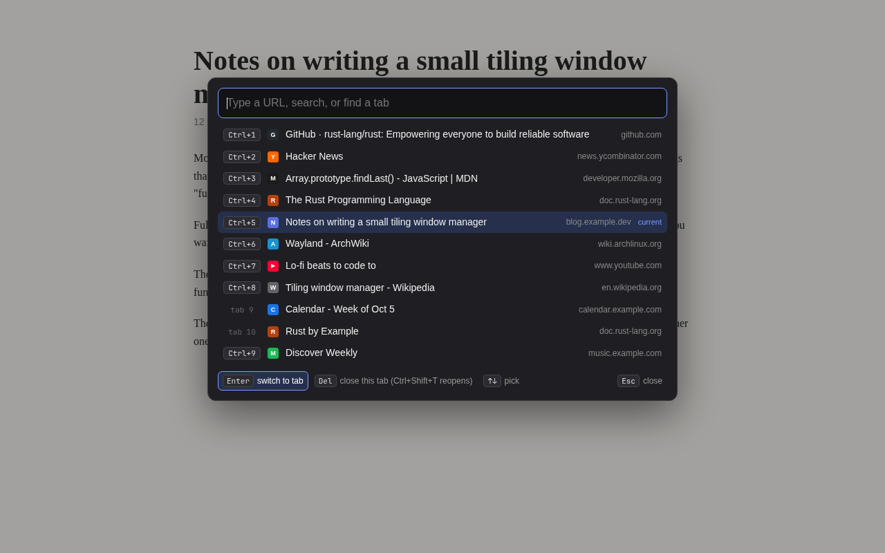

# Go to URL

A Chrome extension: press **Alt+G** to open a URL prompt and tab switcher over the current page. It works in fullscreen, where Chrome hides the address bar.

| Key | Does |
| --- | --- |
| Enter | Open the address or search in this tab, or switch to the selected tab |
| Alt+Enter | Open in a new tab |
| Shift+Enter | Open in a new window |
| ↑ ↓ | Pick a row |
| Del | Close the selected tab |
| Ctrl+Z | Reopen the last tab closed from the prompt |
| Esc / Alt+G | Close the prompt |

On a Mac, Ctrl is ⌘ and Alt is ⌥.

## Install from source
1. Open `chrome://extensions` and turn on **Developer mode**.
2. Click **Load unpacked** and pick this folder.
3. To change Alt+G, go to `chrome://extensions/shortcuts`.

## Files
- `background.js`: handles the shortcut and opens, switches, closes and reopens tabs.
- `ui.js`: the prompt itself, injected into the current page.
- `url.js`: decides whether input is an address or a search.
- `goto.html`: hosts the prompt on pages extensions can't draw over, like `chrome://` pages.
- `package.sh`: builds the Chrome Web Store zip into `dist/`.
- `store/`: listing text, screenshots and promo tile. `store/render.sh` re-renders them from `store/demo.html`.

## Privacy
Nothing leaves your browser. See [PRIVACY.md](PRIVACY.md).

## License
[MIT](LICENSE)
